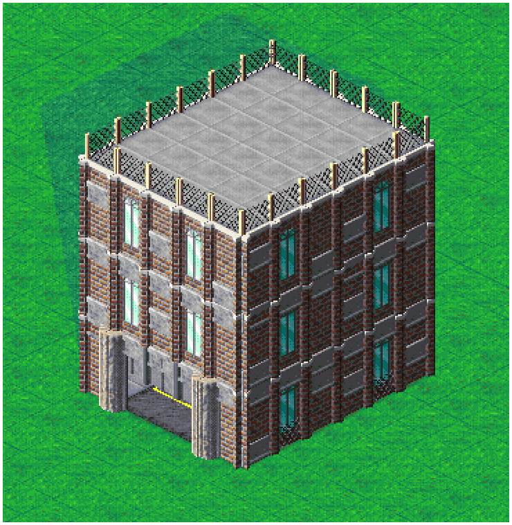
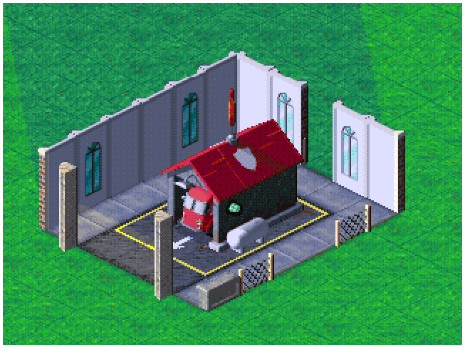
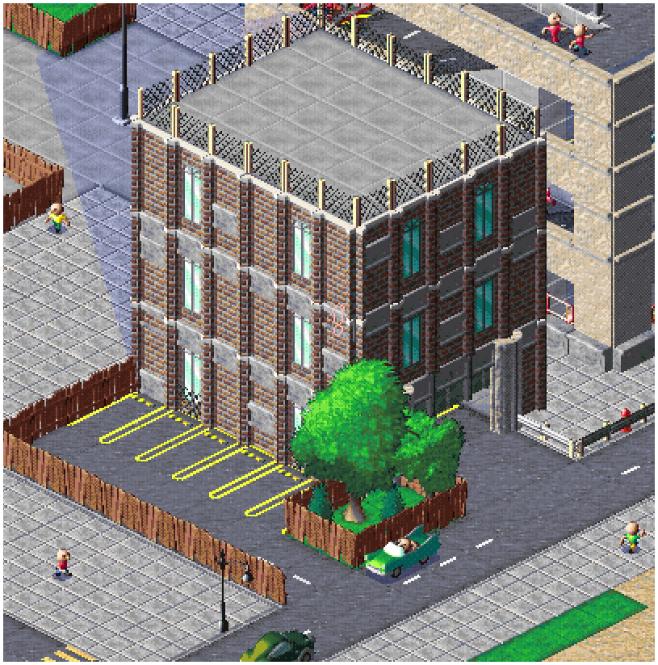

# [Fire-Department-Amerikan]

## 🇩🇪 Deutsch

### Beschreibung
Feuerwehr in einem Amerikanischen NewYork inspiriertem Gebäude

### Gebäudeinformationen

| Eigenschaft | Angaben |
|---|---|
| Ersteller | [XtremeGamingGH] |
| Gebäudetyp | [Fire-Department] |
| Größe | [7 x 8] |
| Baukosten | [7445,5] |

### Bilder

Bilder der Stockwerke

### In-Action

### Download

**[Blueprint herunterladen](Fire-department-1.cpbp)**

### Hinweise

Nach dem Setzten müssen die Wegpunkte noch manuell gesetzt werden

---

# [Blueprint Name]

## 🇬🇧 English

### Description

A fire department housed in an American-style building inspired by the classic fire stations of New York City.

### Building Information

| Property | Details |
|---|---|
| Creator | XtremeGamingGH |
| Building Type | Fire Department |
| Size | 7 x 8 |
| Construction Cost | 7,445.50 |

### Images

Floor images

### In Action

### Download

**[Download Blueprint](Fire-department-1.cpbp)**

### Notes

After placing the blueprint, the waypoints must be set manually.
