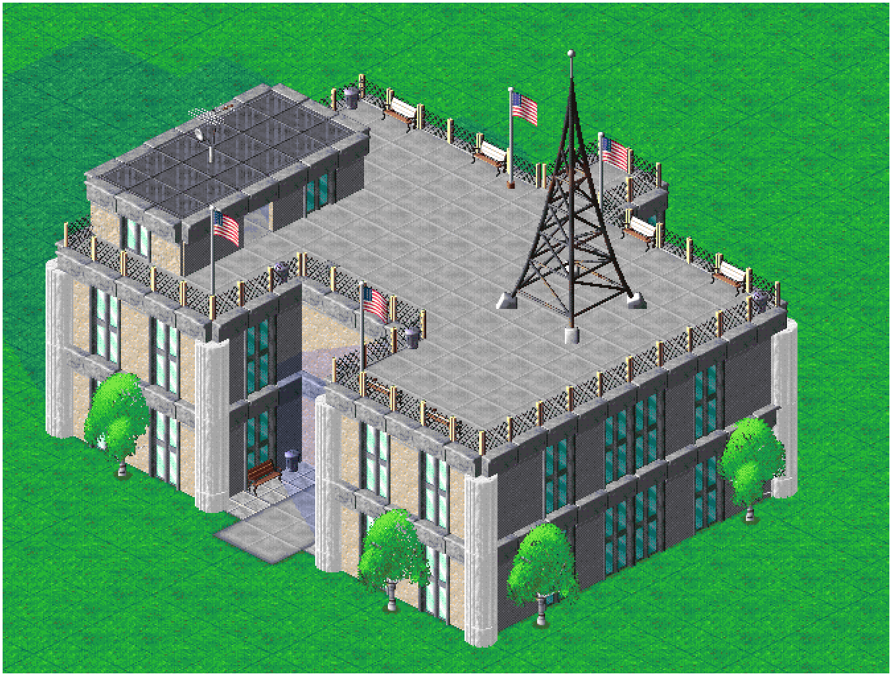
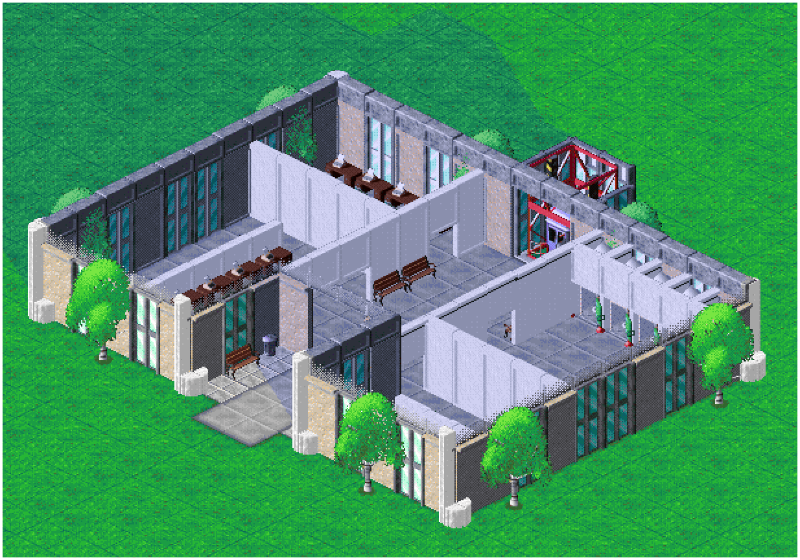
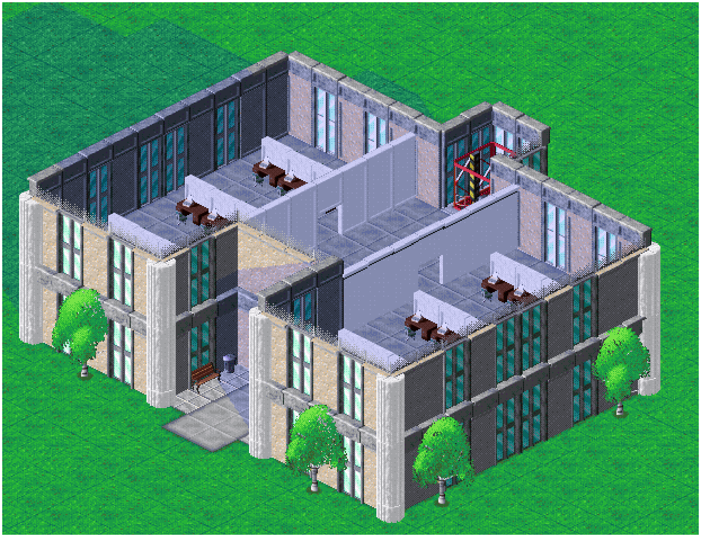

# [Amerikan-Office]

## 🇩🇪 Deutsch

### Beschreibung

Ein Bürogebäude im Amerikanischem Style

### Gebäudeinformationen

| Eigenschaft | Angaben |
|---|---|
| Ersteller | [XtremeGamingGH] |
| Gebäudetyp | [Büro] |
| Größe | [13 x 15]
| Baukosten | [54.175] |
| Besonderheiten | [integrierter Radio-Propagandasender] |

### Bilder

Bilder der eizelnen Stockwerke

### Download

**[Blueprint herunterladen](Amerikan-Office.cpbp)**

### Hinweise

---

## 🇬🇧 English

### Description

An office building in an American style.

### Building Information

| Property | Details |
|---|---|
| Creator | [XtremeGamingGH] |
| Building Type | [Office] |
| Size | [13 x 15] |
| Construction Cost | [54.175] |
| Features | [integrated radio propaganda station] |

### Pictures

Pictures from Floors

### Download

**[Download Blueprint](Amerikan-Office.cpbp)**

### Notes
