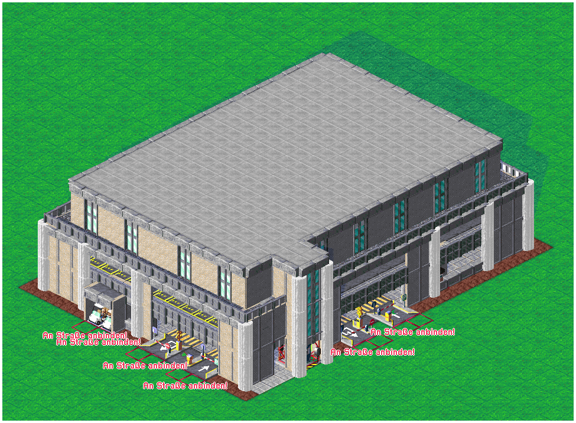
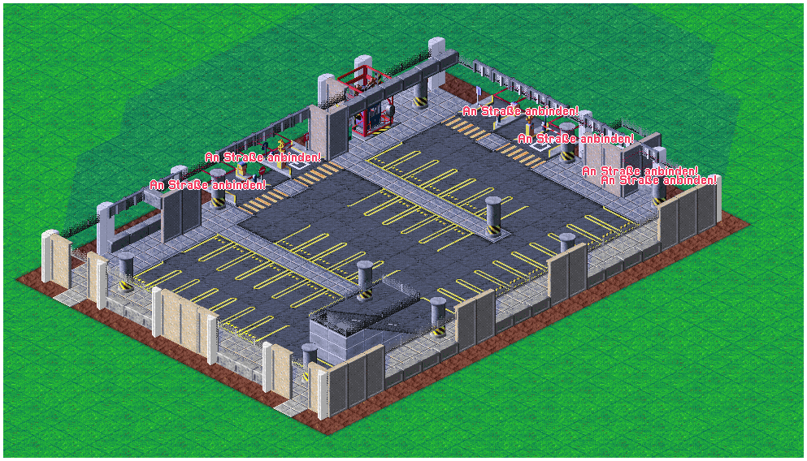
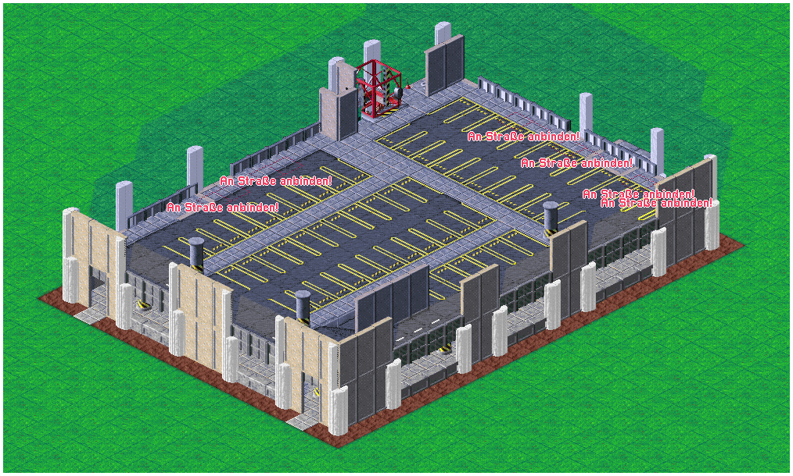
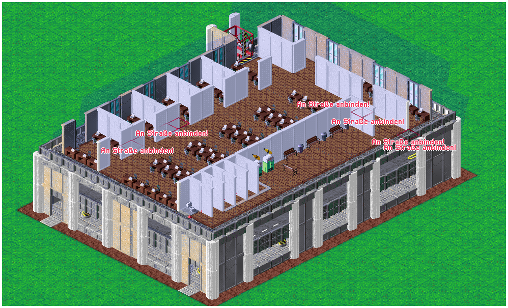
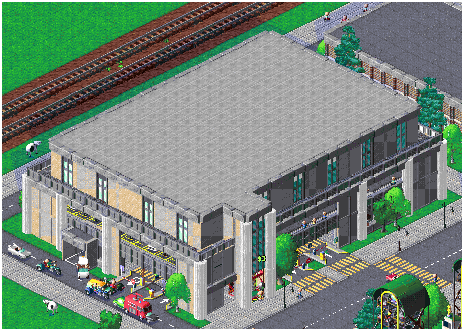
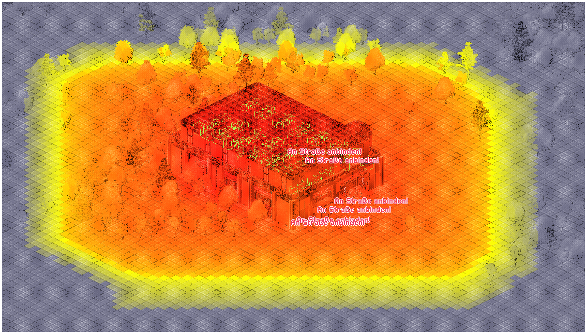

**Language / Sprache:** [🇬🇧 English](#-english) | [🇩🇪 Deutsch](#-deutsch)

# [Office-Parking]

## 🇩🇪 Deutsch

### Beschreibung

Ein mehrstöckiges Parkhaus mit integrierten Büroarbeitsplätzen und moderner Fassade.

### Gebäudeinformationen

| Eigenschaft | Angaben |
|---|---|
| Ersteller | [XtremeGamingGH] |
| Gebäudetyp | [Parkhaus / Büro] |
| Größe | [28 x 17] |
| Baukosten | [78.536,50] |
| Besonderheiten | [Bürogebäude oberhalb des Parkhauses] |

### Bilder

Bilder der Stockwerke

## Parkhaus in Aktion

## Parkdruck

### Download

**[Blueprint herunterladen](Office_Parking.cpbp)**

### Hinweise

Beim Einfügen kann es dazu kommen, das die Shuttleservice Fahrzeuge keine Route anzeigen.
Hier den Fahrzeugen einen Wegpunkt geben, danach sollte alle wieder funktionieren. 

---

## 🇬🇧 English

### Description

A multi-story parking garage with integrated office spaces and a modern facade.

### Building Information

| Property | Details |
|---|---|
| Creator | XtremeGamingGH |
| Building Type | Parking Garage / Office |
| Size | 28 x 17 |
| Construction Cost | 78,536.50 |
| Special Features | Office building above the parking garage |

### Images

Images of the different floors

## Parking Garage in Action

## Parking Demand

### Download

**[Download Blueprint](Office_Parking.cpbp)**

### Notes

After placing the blueprint, the shuttle service vehicles may no longer display their routes.
If this happens, simply assign a waypoint to the affected vehicles. Everything should work normally again afterward.
